# ADR 0001: Extensible reporting with a publication-first rendering boundary

Status: **Accepted for the first milestone only — explicit bounded review**, 2026-10-13. Related: Reports #3, #4, #5, #10. No implementation or dependency change is authorised by this ADR.

## Context

Reports persists SVG and Markdown from structured source notes. Current line and state-table semantics, saved bytes, receipts and explicit command lifecycle must survive expansion. Interactive canvas/DOM outputs cannot substitute for standalone publishable assets. The plugin serves general reporting, not advanced statistical modelling.

## Bounded accepted decision

Keep orchestration/ownership at the existing safety boundary; introduce pure, testable stages when implementation is separately approved. Retain legacy rendering/defaults and normalisation as a compatibility path. A narrow internal presentation model should describe Reports' semantics rather than expose arbitrary engine options as the source schema.

```mermaid
flowchart LR
  A[Markdown discovery and fresh reads] --> B[Definition and source validation]
  B --> C[Selection and explicit transformations]
  C --> D[Declared calculations]
  D --> E[Presentation specification]
  E --> F[SVG or Markdown renderer]
  F --> G[Asset plan]
  G --> H[Existing ownership checks and guarded commit]
  H --> I[Persistent asset and receipt with recovery]
```

1. Discovery/validation: adapter supplies path/frontmatter records and diagnostics; distinguish raw malformed input from an explicit missing-value policy. Legacy definitions continue validating the whole source folder.
2. Selection/transformation: stable ordering, windows, numeric/categorical mappings and named comparisons. Transformations such as binning/aggregation must be declared; no implicit sampling/interpolation. Keep source path/date provenance on selected rows.
3. Calculations: absolute delta only in the first milestone; percentage delta and target variance are later designs. Supplied uncertainty bounds take precedence; computed SD/SE/CI require declared sample convention, sample count, method and confidence level. No hidden regression/model.
4. Presentation: resolved domain, ticks/units/precision, series identity, legend/caption/description, explicit dimensions and print profile. No theme/viewport/current time inputs. Diagnostics for clipping/truncation rather than silent distortion.
5. Rendering: pure SVG/Markdown string output with deterministic escapes, ordering and formatting; engine adapter consumes the same resolved model, not raw vault queries. Preview shows saved asset or identical planned bytes.
6. Asset lifecycle: return output path/content/format to coordinator. Existing receipts, adoption, digest verification, canonical-note exclusion and backup/recovery remain authoritative. Never use renderer IDs as ownership. Start with one output per definition; dual-output KPI proposals need explicit partial-failure/recovery semantics first.

## Options and tradeoffs

- **Custom SVG (accepted for the first milestone only):** no new chart/scale dependency, controlled serialisation and legacy preservation; Reports owns chart/layout/axis/accessibility maintenance.
- **Modular ECharts SVG SSR:** documented string export and broad conventional types; requires fixed dimensions, disabled animation, bounded option adapter, stable IDs and controlled text metrics. Measure actual bundle delta and required notices.
- **Vega-Lite compiled to Vega SVG:** useful grammar/encoding transforms; additional compiler/runtime and overlapping data semantics increase the review surface. Forbid external data loaders and uncontrolled expressions.
- **Chart.js:** good interactive ecosystem, but native canvas export lacks established vector parity; bridge would add complexity without solving source semantics.

Recommend custom SVG for the four-feature milestone. [Bounded comparison](../research/v0.2.0/renderer-review.md) now includes repeated/fresh-process four-series output, direct conversion and a hypothetical coexistence probe. Standalone/probe sizes are not actual integration costs; actual costs require later implementation measurements. No broader chart-engine decision is implied.

## Compatibility and migration

No existing definition must acquire new defaults or silently change axis/table bytes. Proposed fields use an additive opt-in contract and later schema review; unknown keys retained by current editing must not be mistaken for enforced settings. Preserve existing receipt version/path/digest binding, table markers, command IDs, manager behaviour and capability API. Existing outputs are not regenerated on enable/open. Use separate destinations for intentionally different outputs until explicit adoption/regeneration review.

Acceptance: replay unchanged legacy examples through the compatibility path; verify exact asset bytes/receipts and unchanged sources; verify ownership collisions, changed assets, disable races and interrupted writes still block/recover. Add meaningful new tests only when implementing new semantics.

## Reproducibility contract to review

Target identical bytes for identical definition, source snapshot, renderer version and resolved presentation inputs, across repeated process/locale/timezone/theme runs. Freeze endpoint, ordering, precision and dimensions. Asset receipts currently identify ownership and output digest; they are not a complete source-provenance manifest. Decide separately whether a new optional provenance record is useful, without replacing existing receipt safety semantics. Font-identical visual output across platforms requires a font contract; SVG byte identity alone cannot deliver it.

## Bounded decision and review gates

The precise first milestone is **fixed Y bounds, explanatory captions, dash/marker series identification and explicit-pair comparisons**, with the opt-in fields, source-reference contract and unchanged legacy defaults in [first-milestone.md](../research/v0.2.0/first-milestone.md). Both pair observations must be within the source subtree, distinct and strictly date-ordered. References are path-based; missing/renamed/ambiguous paths block generation, never follow guessed identity or substitute a predecessor. No percentage-change convention is accepted.

Publication target: final labels ≥8pt and essential strokes ≥0.5pt. Design widths are 3.5, 4.1 and 5.5 inches, with a named installed font/fallback and no external font fetch. Merged Codex Press `394cf109f035194b440e3b37d75de06e49fe074d` honours authored dimensions within local bounds. [Fresh exact-merge evidence](../research/v0.2.0/p0-acceptance.md) verifies 44 compiler placements, final text sizes, captions and EPUB payloads separately from direct conversion.

**Bounded P0 accepted:** the explicit review accepts custom SVG/no new chart dependency, additive opt-in/legacy boundaries, pair references and width/font/overflow policy for the four-feature milestone only. Broader engine/report decisions remain deferred.

Before implementation starts: review all P0 recommendations, opt-in/legacy boundaries, source-reference semantics and width/font/overflow policy. Before future implementation merges: meaningful new-behaviour and legacy byte/safety tests, actual implementation bundle checks, generated-output publication matrix and disabled-plugin persistence checks. Before print-quality/release claims: physical greyscale proof and product publishing flows. Broader chart types, KPIs, uncertainty, percentage conventions, EPUB reader/assistive-tech qualification and accessible PDF conformance have separate later acceptance gates.

[Codex Press #144](https://github.com/MurmurationPress/codex-press/issues/144) remains separate accessibility compiler work. Successful conversion/EPUBCheck and visible alternatives do not establish accessible PDF; the observed PDFs remain untagged. Acceptance is based on the explicit source/contract/evidence review in [p0-acceptance.md](../research/v0.2.0/p0-acceptance.md), not document completion. Future implementation and qualification gates remain open in [Reports #12](https://github.com/MurmurationPress/murmuration-reports/issues/12).
