# ADR 0001: Extensible reporting with a publication-first rendering boundary

Status: **Proposed — awaiting P0 review**, 2026-10-13. Related: Reports #3, #4, #5, #10. No implementation or dependency change is authorised by this ADR.

## Context

Reports persists SVG and Markdown from structured source notes. Current line and state-table semantics, saved bytes, receipts and explicit command lifecycle must survive expansion. Interactive canvas/DOM outputs cannot substitute for standalone publishable assets. The plugin serves general reporting, not advanced statistical modelling.

## Proposed decision

Keep orchestration/ownership at the existing safety boundary; introduce pure, testable stages when implementation is separately approved. Retain legacy rendering/defaults and normalisation as a compatibility path. A narrow internal presentation model should describe Reports' semantics rather than expose arbitrary engine options as the source schema.

```mermaid
flowchart LR
  A[Markdown discovery and fresh reads] --> B[Definition and source validation]
  B --> C[Selection and explicit transformations]
  C --> D[Declared calculations]
  D --> E[Presentation specification]
  E --> F[SVG or Markdown renderer]
  F --> G[Asset plan]
  G --> H[Existing ownership checks and guarded commit]
  H --> I[Persistent asset and receipt with recovery]
```

1. Discovery/validation: adapter supplies path/frontmatter records and diagnostics; distinguish raw malformed input from an explicit missing-value policy. Legacy definitions continue validating the whole source folder.
2. Selection/transformation: stable ordering, windows, numeric/categorical mappings and named comparisons. Transformations such as binning/aggregation must be declared; no implicit sampling/interpolation. Keep source path/date provenance on selected rows.
3. Calculations: absolute/percentage delta and target variance first. Supplied uncertainty bounds take precedence; computed SD/SE/CI require declared sample convention, sample count, method and confidence level. No hidden regression/model.
4. Presentation: resolved domain, ticks/units/precision, series identity, legend/caption/description, explicit dimensions and print profile. No theme/viewport/current time inputs. Diagnostics for clipping/truncation rather than silent distortion.
5. Rendering: pure SVG/Markdown string output with deterministic escapes, ordering and formatting; engine adapter consumes the same resolved model, not raw vault queries. Preview shows saved asset or identical planned bytes.
6. Asset lifecycle: return output path/content/format to coordinator. Existing receipts, adoption, digest verification, canonical-note exclusion and backup/recovery remain authoritative. Never use renderer IDs as ownership. Start with one output per definition; dual-output KPI proposals need explicit partial-failure/recovery semantics first.

## Options and tradeoffs

- **Custom SVG / selected scale helpers (provisional preference):** low incremental dependencies, controlled serialisation and legacy preservation; Reports owns chart/layout/axis/accessibility maintenance.
- **Modular ECharts SVG SSR:** documented string export and broad conventional types; requires fixed dimensions, disabled animation, bounded option adapter, stable IDs and controlled text metrics. Measure actual bundle delta and required notices.
- **Vega-Lite compiled to Vega SVG:** useful grammar/encoding transforms; additional compiler/runtime and overlapping data semantics increase the review surface. Forbid external data loaders and uncontrolled expressions.
- **Chart.js:** good interactive ecosystem, but native canvas export lacks established vector parity; bridge would add complexity without solving source semantics.

Plugin release sizes in the survey establish ecosystem scale, not measured engine-only costs. No final engine selection until comparable isolated spike results exist.

## Compatibility and migration

No existing definition must acquire new defaults or silently change axis/table bytes. Proposed fields use an additive opt-in contract and later schema review; unknown keys retained by current editing must not be mistaken for enforced settings. Preserve existing receipt version/path/digest binding, table markers, command IDs, manager behaviour and capability API. Existing outputs are not regenerated on enable/open. Use separate destinations for intentionally different outputs until explicit adoption/regeneration review.

Acceptance: replay unchanged legacy examples through the compatibility path; verify exact asset bytes/receipts and unchanged sources; verify ownership collisions, changed assets, disable races and interrupted writes still block/recover. Add meaningful new tests only when implementing new semantics.

## Reproducibility contract to review

Target identical bytes for identical definition, source snapshot, renderer version and resolved presentation inputs, across repeated process/locale/timezone/theme runs. Freeze endpoint, ordering, precision and dimensions. Asset receipts currently identify ownership and output digest; they are not a complete source-provenance manifest. Decide separately whether a new optional provenance record is useful, without replacing existing receipt safety semantics. Font-identical visual output across platforms requires a font contract; SVG byte identity alone cannot deliver it.

## Review gates and unresolved questions

- Measure raw/gzip engine deltas, startup and generation costs in isolated builds; agree a numerical budget before adding dependencies.
- Compare renderer candidates on the same fixtures and publication outputs; record font/ID/animation/resource evidence.
- Approve percent-change denominator, missing/invalid policy, explicit-pair identity/rename handling and fixed-domain clipping behaviour.
- Resolve print font distribution/licensing versus portability and accessible text; do not solve it by outlining all text without an equivalent text alternative.
- Review all P0 recommendations before any implementation PR. Keep v0.2.0 scope bounded to the first reviewed milestone.

## Initial experiment update

[Isolated measurements](../research/v0.2.0/renderer-spike-results.json) found modular ECharts line/scatter/bar at 533,910 raw / 183,266 gzip bytes and Vega-Lite+Vega at 783,418 / 270,843 bytes for the stated exports; d3-scale linear/log/band is 24,112 / 9,729 bytes. These are standalone costs, not Reports integration deltas. ECharts SVG classes change between repeated instances in one process, even with animation disabled. A class-token and clip-ID/reference remapping diagnostic removes differences in the simple case; a robust adapter still needs XML/CSS-reference-aware deterministic identifiers and broader tests. Vega repeats exactly for this simple example. This strengthens the provisional custom-SVG preference but does not accept a final renderer decision.
