# Reporting publication fixtures

Synthetic data only. Hand-authored visual specifications, not new Reports output or implemented report types. All SVGs are local and self-contained. June versus May is the comparison period where applicable.

## Line Fixed

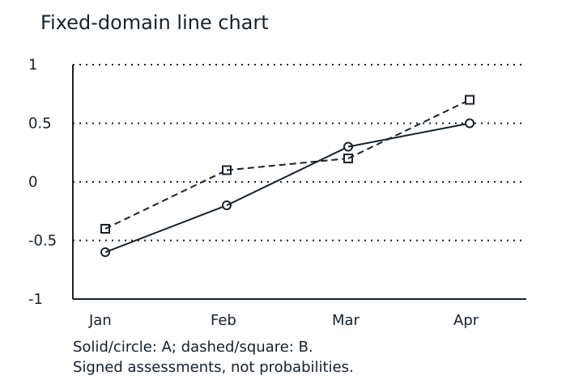

Descriptive alternative: Two series on a fixed minus one to plus one scale. A rises from minus 0.6 to 0.5; B from minus 0.4 to 0.7.

## Four-series identity

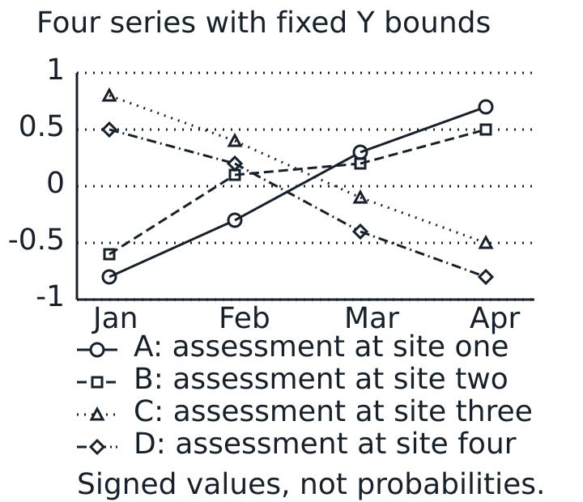

Descriptive alternative: Solid circles, dashed squares, dotted triangles and dash-dot diamonds identify four synthetic series. All values stay within −1…+1.

## Scatter Error

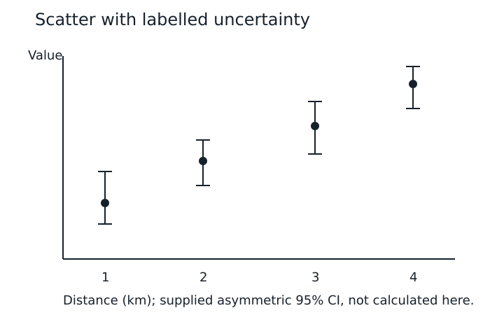

Descriptive alternative: Four numeric XY observations, values increase with distance. Asymmetric error bars are supplied 95 percent confidence bounds.

## Bar

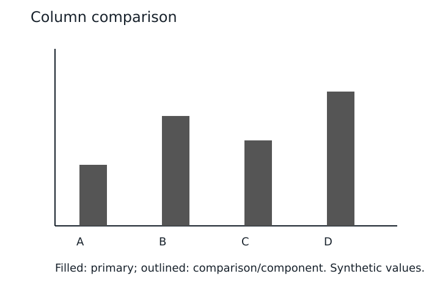

Descriptive alternative: Four ordered categories. Filled and outlined bars distinguish components without colour. See accompanying data alternative.

## Grouped Bars

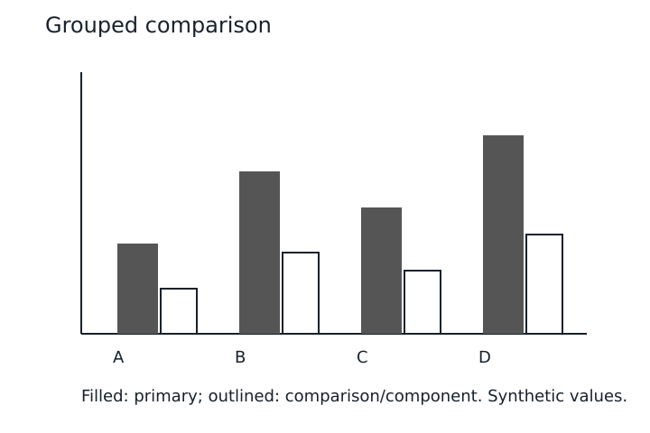

Descriptive alternative: Four ordered categories. Filled and outlined bars distinguish components without colour. See accompanying data alternative.

## Stacked Bars

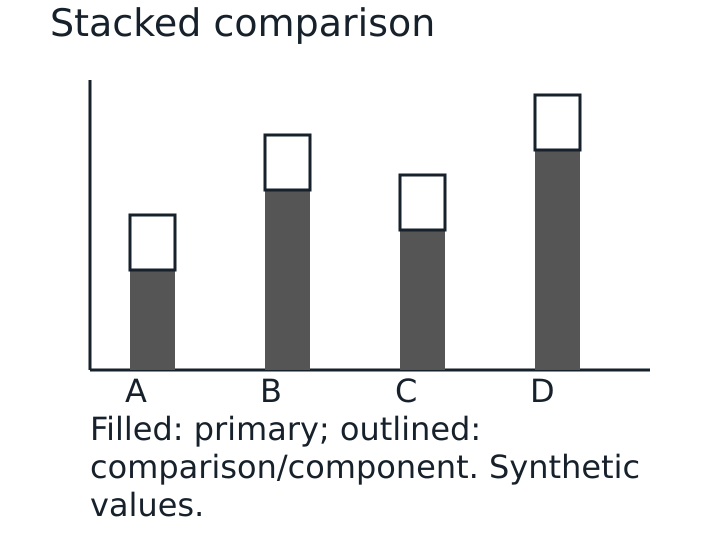

Descriptive alternative: Four ordered categories. Filled and outlined bars distinguish components without colour. See accompanying data alternative.

## Histogram

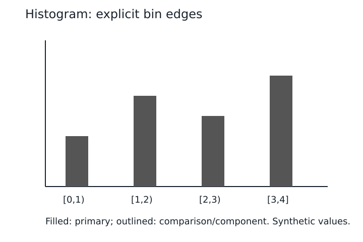

Descriptive alternative: Four ordered categories. Filled and outlined bars distinguish components without colour. See accompanying data alternative.

## Pie

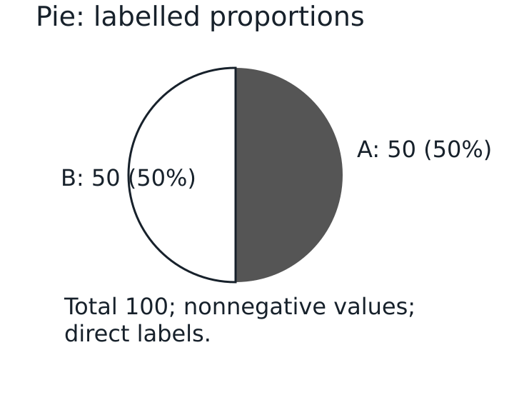

Descriptive alternative: Two equal categories, A 50 and B 50, each 50 percent; total 100.

## Doughnut

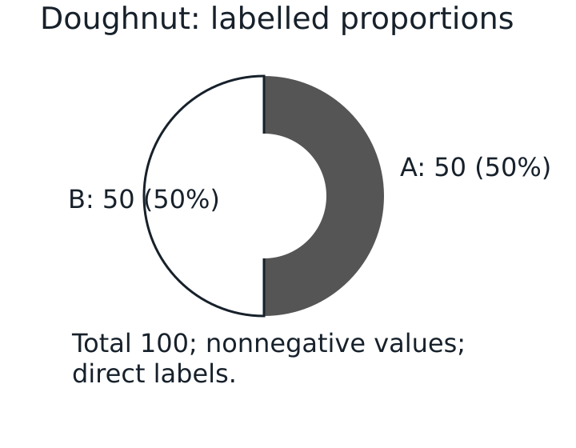

Descriptive alternative: Two equal categories, A 50 and B 50, each 50 percent; total 100.

## Radar

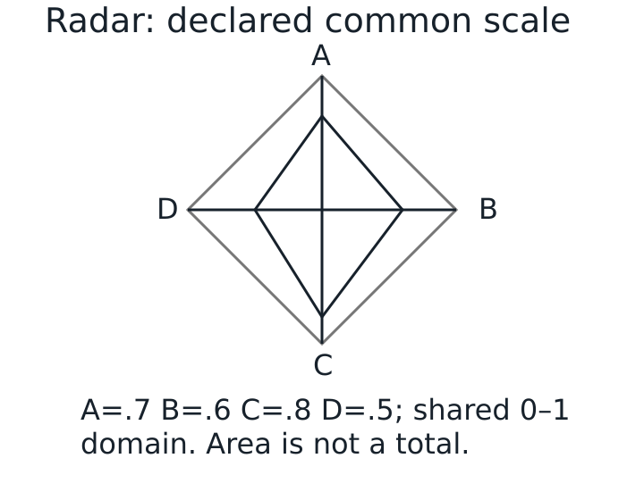

Descriptive alternative: Ordered dimensions A B C D share zero to one domain. Values 0.7, 0.6, 0.8, 0.5. Area is not a total.

## Scorecard

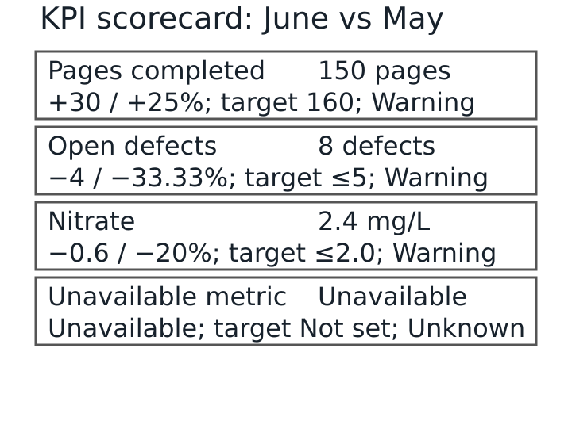

Descriptive alternative: Three synthetic KPIs are warning; fourth metric is unavailable with unknown status. See Markdown alternative for directions and periods.

## Explicit-pair comparison

Current June-end = 15; explicit previous May = 10; inserted June-middle = 12. Explicit-pair delta remains +5; canonical-predecessor delta becomes +3. This fixture documents the rule and does not execute a future comparison implementation.

| Metric | Current | Previous | Absolute delta |
| --- | ---: | ---: | ---: |
| Explicit May-to-June | +15.00 | +10.00 | +5.00 |
| Canonical after insertion | +15.00 | +12.00 | +3.00 |

Both rows are illustrative; the first milestone preserves signed two-decimal table formatting and adds no percentage-change policy.

## Later KPI design specimen (outside first milestone)

| KPI | June / May | Target | Direction | Status |
| --- | --- | --- | --- | --- |
| Pages completed | 150 / 120 pages | 160 | Higher | Warning |
| Open defects | 8 / 12 defects | ≤5 | Lower | Warning |
| Nitrate | 2.4 / 3.0 mg/L | ≤2.0 | Lower | Warning |
| Unavailable metric | Unavailable | Not set | Unspecified | Unknown |

## Multi-page structured table

Long labels and units test wrapping. Row markers must occur once each in PDF text; continuation headings should repeat. Full report-level column-width design remains pending.

| Observation | Parameter with a deliberately long heading | Current (mg/L) | Previous (mg/L) | Delta (mg/L) |
| --- | --- | ---: | ---: | ---: |
| ROW001 | Synthetic monitoring parameter 1 | 2.40 | 3.00 | −0.60 |
| ROW002 | Synthetic monitoring parameter 2 | 2.40 | 3.00 | −0.60 |
| ROW003 | Synthetic monitoring parameter 3 | 2.40 | 3.00 | −0.60 |
| ROW004 | Synthetic monitoring parameter 4 | 2.40 | 3.00 | −0.60 |
| ROW005 | Synthetic monitoring parameter 5 | 2.40 | 3.00 | −0.60 |
| ROW006 | Synthetic monitoring parameter 6 | 2.40 | 3.00 | −0.60 |
| ROW007 | Synthetic monitoring parameter 7 | 2.40 | 3.00 | −0.60 |
| ROW008 | Synthetic monitoring parameter 8 | 2.40 | 3.00 | −0.60 |
| ROW009 | Synthetic monitoring parameter 9 | 2.40 | 3.00 | −0.60 |
| ROW010 | Synthetic monitoring parameter 10 | 2.40 | 3.00 | −0.60 |
| ROW011 | Synthetic monitoring parameter 11 | 2.40 | 3.00 | −0.60 |
| ROW012 | Synthetic monitoring parameter 12 | 2.40 | 3.00 | −0.60 |
| ROW013 | Synthetic monitoring parameter 13 | 2.40 | 3.00 | −0.60 |
| ROW014 | Synthetic monitoring parameter 14 | 2.40 | 3.00 | −0.60 |
| ROW015 | Synthetic monitoring parameter 15 | 2.40 | 3.00 | −0.60 |
| ROW016 | Synthetic monitoring parameter 16 | 2.40 | 3.00 | −0.60 |
| ROW017 | Synthetic monitoring parameter 17 | 2.40 | 3.00 | −0.60 |
| ROW018 | Synthetic monitoring parameter 18 | 2.40 | 3.00 | −0.60 |
| ROW019 | Synthetic monitoring parameter 19 | 2.40 | 3.00 | −0.60 |
| ROW020 | Synthetic monitoring parameter 20 | 2.40 | 3.00 | −0.60 |
| ROW021 | Synthetic monitoring parameter 21 | 2.40 | 3.00 | −0.60 |
| ROW022 | Synthetic monitoring parameter 22 | 2.40 | 3.00 | −0.60 |
| ROW023 | Synthetic monitoring parameter 23 | 2.40 | 3.00 | −0.60 |
| ROW024 | Synthetic monitoring parameter 24 | 2.40 | 3.00 | −0.60 |
| ROW025 | Synthetic monitoring parameter 25 | 2.40 | 3.00 | −0.60 |
| ROW026 | Synthetic monitoring parameter 26 | 2.40 | 3.00 | −0.60 |
| ROW027 | Synthetic monitoring parameter 27 | 2.40 | 3.00 | −0.60 |
| ROW028 | Synthetic monitoring parameter 28 | 2.40 | 3.00 | −0.60 |
| ROW029 | Synthetic monitoring parameter 29 | 2.40 | 3.00 | −0.60 |
| ROW030 | Synthetic monitoring parameter 30 | 2.40 | 3.00 | −0.60 |
| ROW031 | Synthetic monitoring parameter 31 | 2.40 | 3.00 | −0.60 |
| ROW032 | Synthetic monitoring parameter 32 | 2.40 | 3.00 | −0.60 |
| ROW033 | Synthetic monitoring parameter 33 | 2.40 | 3.00 | −0.60 |
| ROW034 | Synthetic monitoring parameter 34 | 2.40 | 3.00 | −0.60 |
| ROW035 | Synthetic monitoring parameter 35 | 2.40 | 3.00 | −0.60 |
| ROW036 | Synthetic monitoring parameter 36 | 2.40 | 3.00 | −0.60 |
| ROW037 | Synthetic monitoring parameter 37 | 2.40 | 3.00 | −0.60 |
| ROW038 | Synthetic monitoring parameter 38 | 2.40 | 3.00 | −0.60 |
| ROW039 | Synthetic monitoring parameter 39 | 2.40 | 3.00 | −0.60 |
| ROW040 | Synthetic monitoring parameter 40 | 2.40 | 3.00 | −0.60 |
| ROW041 | Synthetic monitoring parameter 41 | 2.40 | 3.00 | −0.60 |
| ROW042 | Synthetic monitoring parameter 42 | 2.40 | 3.00 | −0.60 |
| ROW043 | Synthetic monitoring parameter 43 | 2.40 | 3.00 | −0.60 |
| ROW044 | Synthetic monitoring parameter 44 | 2.40 | 3.00 | −0.60 |
| ROW045 | Synthetic monitoring parameter 45 | 2.40 | 3.00 | −0.60 |
| ROW046 | Synthetic monitoring parameter 46 | 2.40 | 3.00 | −0.60 |
| ROW047 | Synthetic monitoring parameter 47 | 2.40 | 3.00 | −0.60 |
| ROW048 | Synthetic monitoring parameter 48 | 2.40 | 3.00 | −0.60 |
| ROW049 | Synthetic monitoring parameter 49 | 2.40 | 3.00 | −0.60 |
| ROW050 | Synthetic monitoring parameter 50 | 2.40 | 3.00 | −0.60 |
| ROW051 | Synthetic monitoring parameter 51 | 2.40 | 3.00 | −0.60 |
| ROW052 | Synthetic monitoring parameter 52 | 2.40 | 3.00 | −0.60 |
| ROW053 | Synthetic monitoring parameter 53 | 2.40 | 3.00 | −0.60 |
| ROW054 | Synthetic monitoring parameter 54 | 2.40 | 3.00 | −0.60 |
| ROW055 | Synthetic monitoring parameter 55 | 2.40 | 3.00 | −0.60 |
| ROW056 | Synthetic monitoring parameter 56 | 2.40 | 3.00 | −0.60 |
| ROW057 | Synthetic monitoring parameter 57 | 2.40 | 3.00 | −0.60 |
| ROW058 | Synthetic monitoring parameter 58 | 2.40 | 3.00 | −0.60 |
| ROW059 | Synthetic monitoring parameter 59 | 2.40 | 3.00 | −0.60 |
| ROW060 | Synthetic monitoring parameter 60 | 2.40 | 3.00 | −0.60 |
| ROW061 | Synthetic monitoring parameter 61 | 2.40 | 3.00 | −0.60 |
| ROW062 | Synthetic monitoring parameter 62 | 2.40 | 3.00 | −0.60 |
| ROW063 | Synthetic monitoring parameter 63 | 2.40 | 3.00 | −0.60 |
| ROW064 | Synthetic monitoring parameter 64 | 2.40 | 3.00 | −0.60 |
| ROW065 | Synthetic monitoring parameter 65 | 2.40 | 3.00 | −0.60 |
| ROW066 | Synthetic monitoring parameter 66 | 2.40 | 3.00 | −0.60 |
| ROW067 | Synthetic monitoring parameter 67 | 2.40 | 3.00 | −0.60 |
| ROW068 | Synthetic monitoring parameter 68 | 2.40 | 3.00 | −0.60 |
| ROW069 | Synthetic monitoring parameter 69 | 2.40 | 3.00 | −0.60 |
| ROW070 | Synthetic monitoring parameter 70 | 2.40 | 3.00 | −0.60 |
| ROW071 | Synthetic monitoring parameter 71 | 2.40 | 3.00 | −0.60 |
| ROW072 | Synthetic monitoring parameter 72 | 2.40 | 3.00 | −0.60 |
| ROW073 | Synthetic monitoring parameter 73 | 2.40 | 3.00 | −0.60 |
| ROW074 | Synthetic monitoring parameter 74 | 2.40 | 3.00 | −0.60 |
| ROW075 | Synthetic monitoring parameter 75 | 2.40 | 3.00 | −0.60 |
| ROW076 | Synthetic monitoring parameter 76 | 2.40 | 3.00 | −0.60 |
| ROW077 | Synthetic monitoring parameter 77 | 2.40 | 3.00 | −0.60 |
| ROW078 | Synthetic monitoring parameter 78 | 2.40 | 3.00 | −0.60 |
| ROW079 | Synthetic monitoring parameter 79 | 2.40 | 3.00 | −0.60 |
| ROW080 | Synthetic monitoring parameter 80 | 2.40 | 3.00 | −0.60 |
